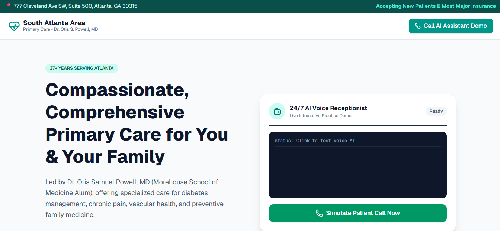
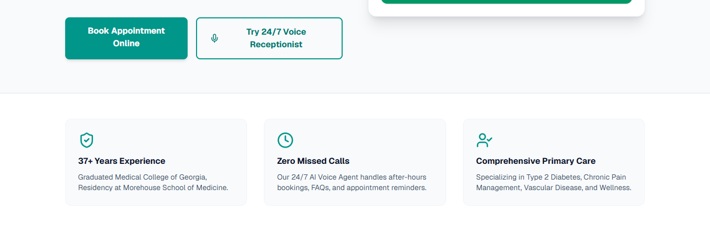

# AI Voice Receptionist — Landing Page & Interactive Demo

A landing page for Dr. Otis S. Powell, MD's primary care practice in Atlanta, with an interactive demo of a 24/7 AI voice receptionist. Built and delivered to a real Atlanta medical practice.

## Screenshots





## What it does

- **Practice landing page** — hero, location, and services for a primary care practice (accepting new patients, most major insurance)
- **24/7 AI voice receptionist demo** — an interactive walkthrough of an AI intake call: connecting, live call, and lead captured, showing how the receptionist answers when the front desk can't
- **Why it matters sections** — 37+ years experience, zero missed calls (after-hours bookings, FAQs, appointment reminders), and comprehensive primary care (Type 2 diabetes, chronic pain management, vascular disease, wellness)

Note: the demo on this page is a simulated call flow — it walks visitors through exactly how an AI receptionist handles a call, without needing a live phone line.

## Tech stack

- **Framework:** Next.js 16 (App Router) + React 19 + TypeScript
- **Styling:** Tailwind CSS v4
- **Icons:** lucide-react

## Run it locally

```bash
npm install
npm run dev
```

Open [http://localhost:3000](http://localhost:3000) in your browser.

Other commands:

```bash
npm run build   # production build
npm run start   # run the production build
npm run lint    # lint
```

## Project structure

```
app/
  page.tsx      # the landing page + interactive receptionist demo
  layout.tsx    # root layout
  globals.css   # global styles
public/         # static assets
```

## Status

Built for a real client practice and deployed live. This repo holds the landing page and demo front end — the business proof for the AI receptionist service.
